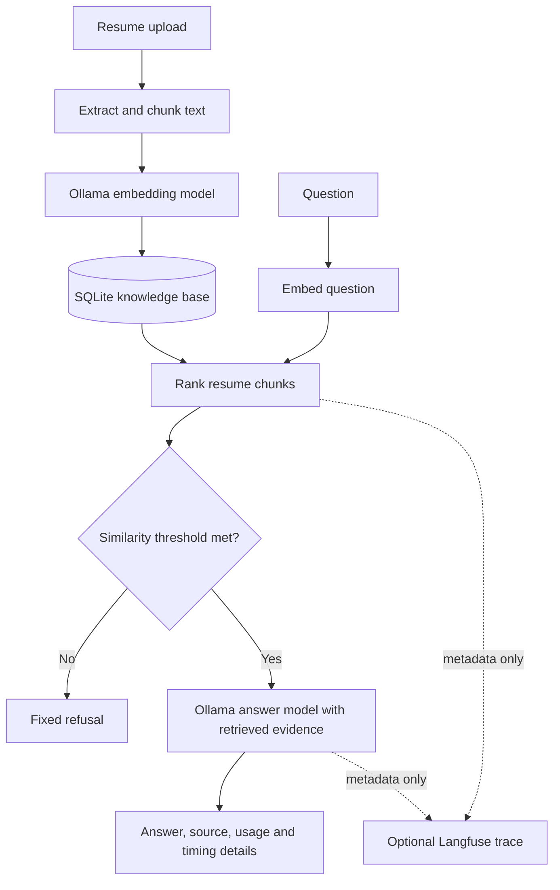

# Resume Room

A local resume chatbot using Ollama for embeddings and answers. Upload one PDF,
TXT, or Markdown resume; the app chunks it into a persistent SQLite knowledge
base and answers only when retrieved resume evidence clears a similarity
threshold. The active resume replaces the previous one.

## Requirements

- Python 3.10+
- [Ollama](https://ollama.com/) running locally
- A generation model and an embedding model pulled into Ollama

## Run

```powershell
ollama pull llama3.2:3b
ollama pull nomic-embed-text
python -m venv .venv
.\.venv\Scripts\Activate.ps1
python -m pip install -e ".[test]"
resume-chat
```

Open http://127.0.0.1:8000. Select or drop a PDF, TXT, or MD resume, then ask a
question. The SQLite knowledge base is stored under `data/knowledge.sqlite3`.
The app binds to localhost by default and stores extracted resume chunks and
embeddings locally; it does not retain the original upload.

## Architecture

Open the [architecture page](static/architecture.html) in the project or visit
`http://127.0.0.1:8000/architecture` while the chatbot is running. It diagrams
resume indexing separately from question answering, including the retrieval
threshold refusal path and metadata-only Langfuse diagnostics.



## Configuration

| Variable | Default | Purpose |
| --- | --- | --- |
| `OLLAMA_MODEL` | `llama3.2:3b` | Answer generation model |
| `OLLAMA_EMBEDDING_MODEL` | `nomic-embed-text` | Resume and query embedding model |
| `RAG_MIN_SIMILARITY` | `0.35` | Minimum cosine similarity required to send evidence to the answer model |
| `RESUME_KNOWLEDGE_DB` | `data/knowledge.sqlite3` | SQLite knowledge-base path |
| `LANGFUSE_PUBLIC_KEY` | unset | Enables Langfuse tracing when used with the secret key |
| `LANGFUSE_SECRET_KEY` | unset | Enables Langfuse tracing when used with the public key |
| `LANGFUSE_HOST` | SDK default | Langfuse server URL, if self-hosted |
| `LOG_LEVEL` | `INFO` | Python log level |

Each chat response includes its retrieval similarity and threshold, whether it
was grounded, Ollama prompt/completion token counts, prompt and generation
timings, throughput, total latency, and a request ID. Similarity is a retrieval
signal, not a measured statistical precision or guarantee of answer accuracy.
Logs and Langfuse metadata include these diagnostics but exclude resume text
and the raw question. Langfuse is disabled unless both keys are configured.

The retrieval gate and system prompt are defense-in-depth guardrails, not a
security boundary against every possible prompt injection. Review answers
before relying on them for hiring or other high-impact decisions.

## Test

```powershell
python -m pytest
```